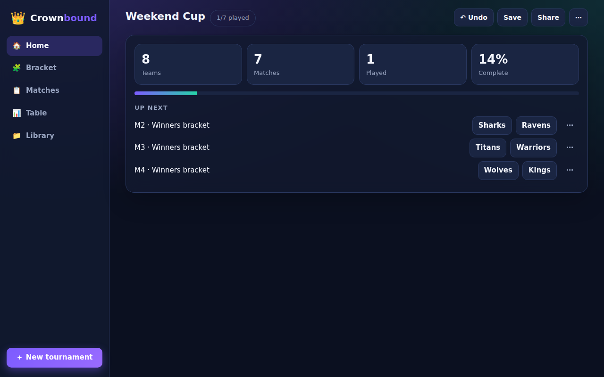
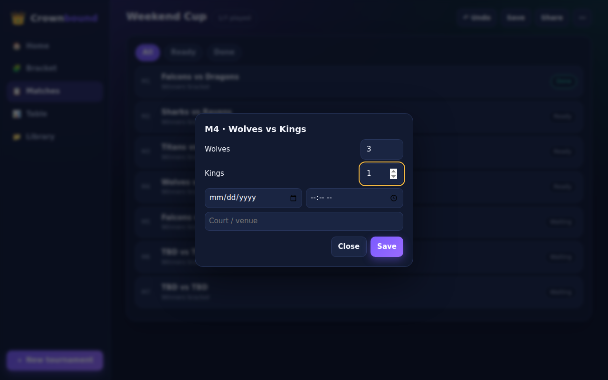
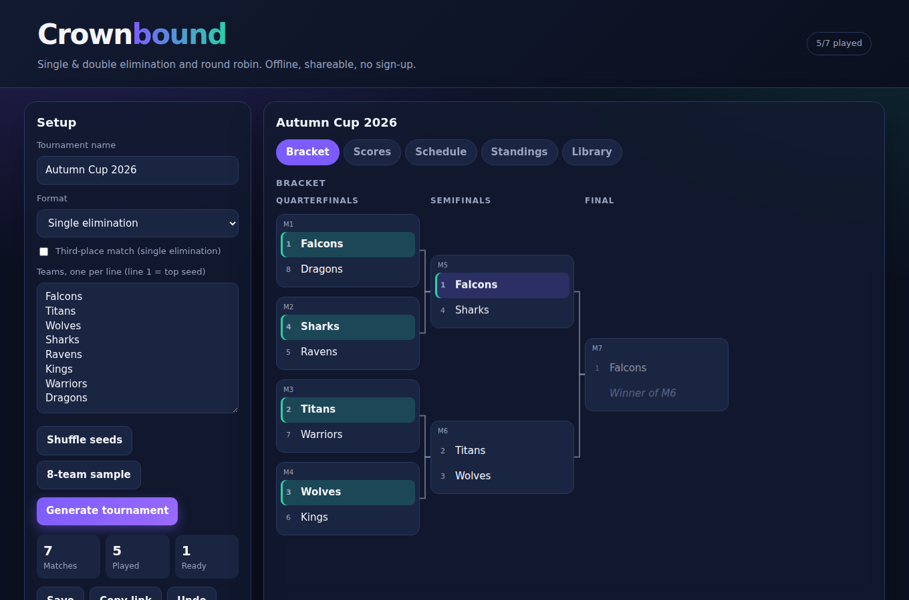
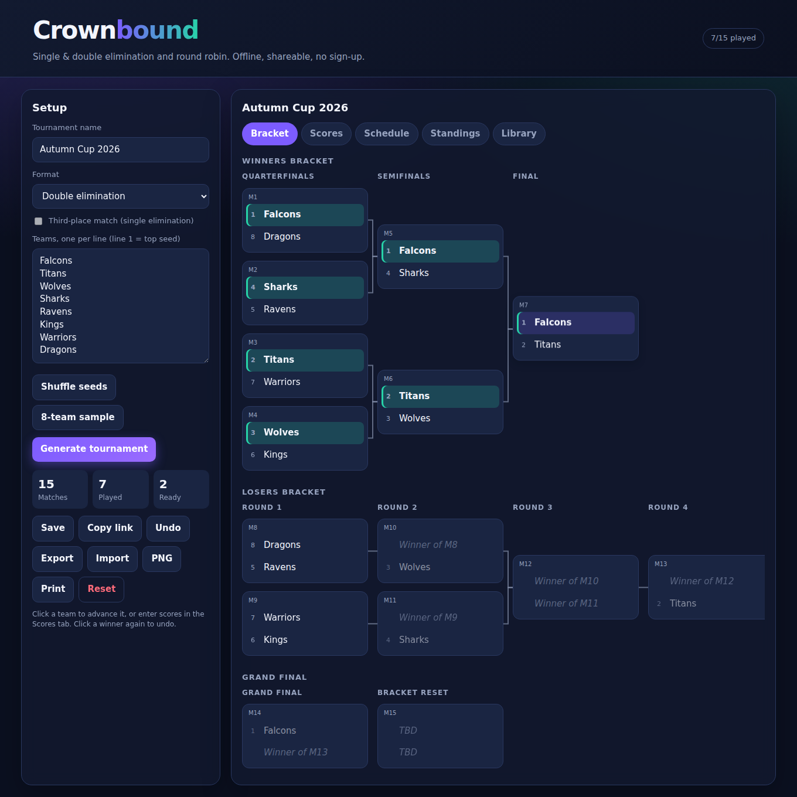
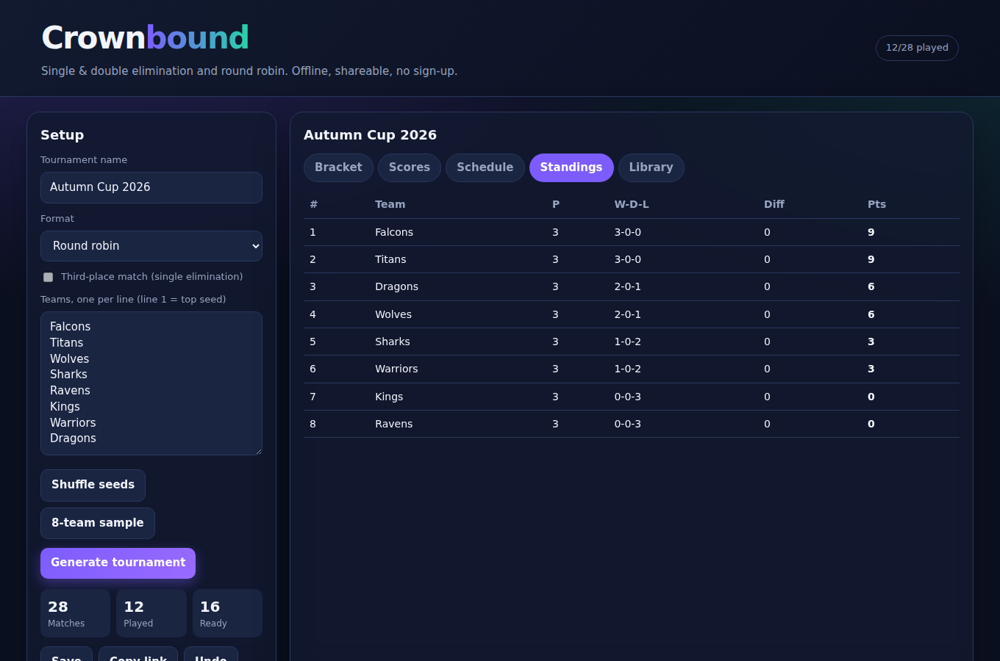
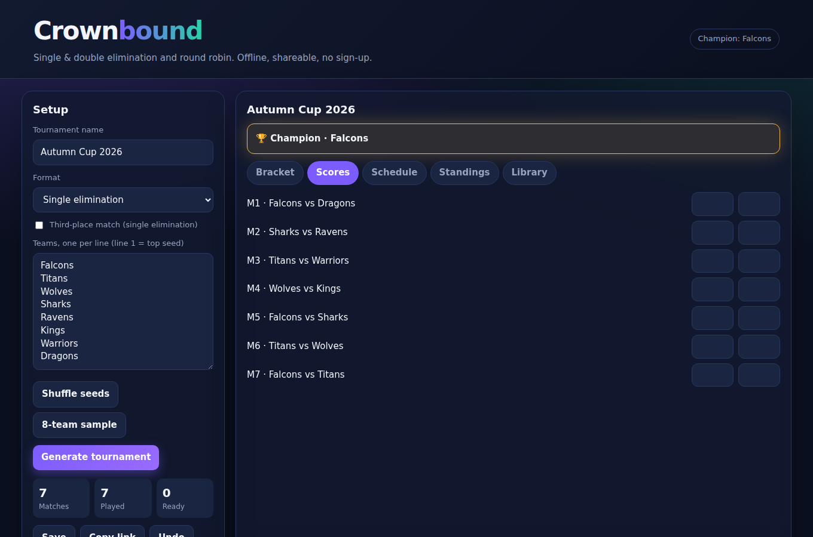

# Crownbound
Offline-first tournament manager (formerly BracketForge). Single elimination, double elimination (with bracket reset) and round robin. Vanilla JavaScript, no build step, no dependencies, installable as a PWA.

| Home | Match dialog |
|---|---|
|  |  |

| Single elimination | Double elimination |
|---|---|
|  |  |

| Round robin standings | Champion crowned |
|---|---|
|  |  |

## Features
- **App shell:** sidebar navigation (bottom tab bar and floating button on phones), Home dashboard with KPIs, progress and an "Up next" list with one-tap results, Matches list with filters, match dialog for scores and schedule, new-tournament dialog
- **Correct seeding:** best-vs-worst pairings every round; with an odd count only one team skips a round (the best seed without a bye yet), so nobody sits out needlessly
- **Double elimination:** winners bracket, losers bracket, grand final and a reset game only when the losers-side finalist wins
- **Round robin:** circle-method matchdays, draws, standings by points, goal difference then points scored
- **Results:** click-to-advance or score entry, ties rejected in knockout play, changing an earlier result safely clears stale downstream results
- **Third-place match**, 50-step undo, autosave, saved-tournament library
- **Share and move data:** copy a link that reopens the exact tournament state, JSON export/import with validation
- **Schedule:** date, time and court per match, shown on the bracket cards and kept in share links
- **Bracket view:** auto-drawn connector lines, responsive layout, light/dark theme, print stylesheet and one-click PNG export of the whole bracket
- **Delete and recover:** confirm-before-delete dialogs, "Undo" on deleted tournaments and Library items, reset results, keyboard shortcuts (N new, Ctrl+Z undo)
- **Safe rendering:** team names are never parsed as HTML

## Run and test
```
npm start   # http://localhost:8000
npm test    # 13 engine tests, Node's built-in runner
```
## Structure
`js/engine.js` pure tournament engine (match graph, resolver, standings, share codec) · `js/app.js` UI · `css/styles.css` · `sw.js` + `manifest.webmanifest` offline/install · `tests/engine.test.js`

## Resume bullets
- Built an offline-first PWA bracket manager in vanilla JS supporting single/double elimination and round robin
- Designed a DOM-free match-graph engine where winners and losers propagate through dependency links, covering byes, grand-final resets and stale-result invalidation, with 13 unit tests
- Added shareable state links, validated JSON import/export, undo history and XSS-safe rendering
